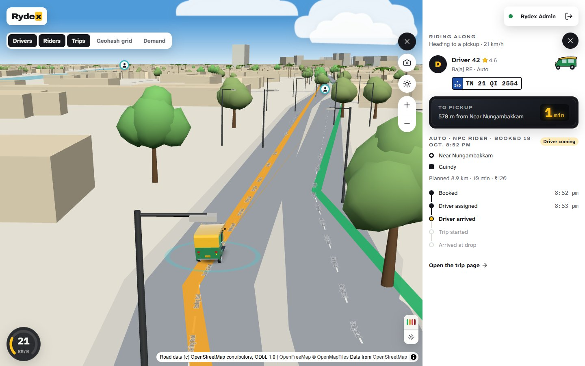
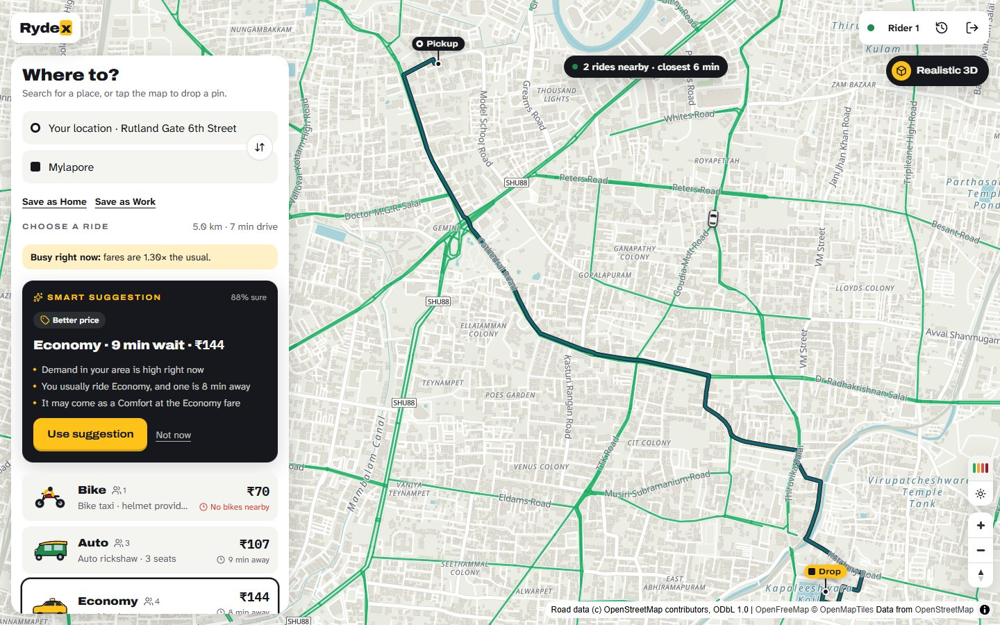
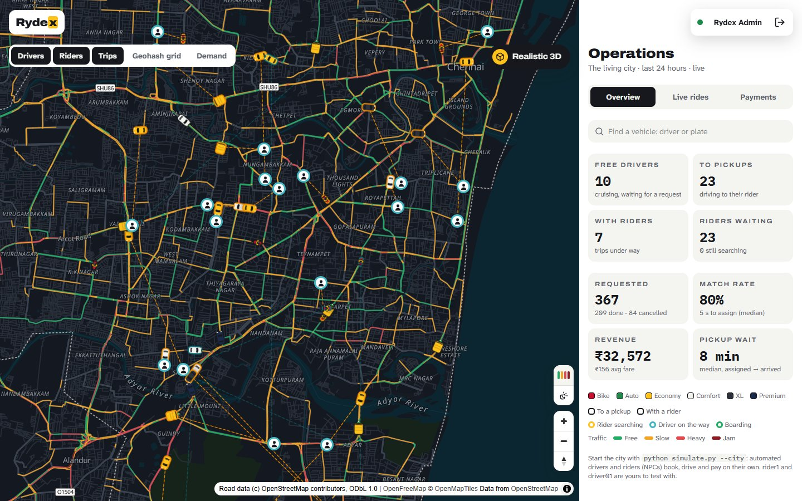
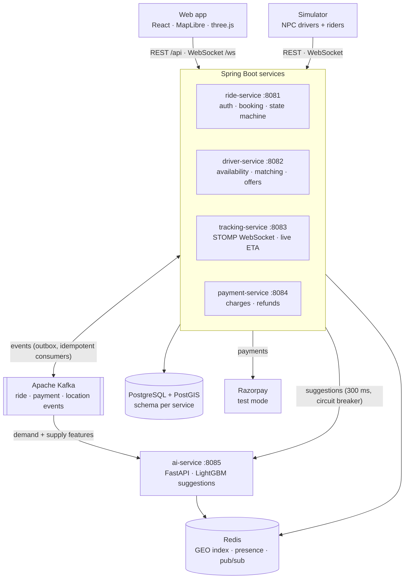

<div align="center">

# Rydex

**Uber-style ride hailing with live driver tracking, a living simulated city and a 3D chase camera, built on free tiers only.**

[](https://github.com/Boovesh985/rydex/actions/workflows/ci.yml)
[](LICENSE)


[Features](#features) · [Architecture](#architecture) · [Getting started](#getting-started) · [Guide](docs/GUIDE.md) · [Decisions](docs/adr) · [Roadmap](#roadmap)



</div>

## About

Rydex is a ride-hailing platform in the spirit of Uber and Ola, set in Chennai: riders book bikes, autos and cabs, drivers get offers and drive the trip, and operations watch the whole city live. Four Spring Boot services talk over Kafka with a transactional outbox, and live positions travel over WebSockets. A Python AI service suggests the best ride, time and pickup spot, and a Python simulator fills the city with automated drivers and riders who book, drive, pay and rate on their own.

Everything runs locally with Docker, and the deployment plan uses free tiers only (Oracle Cloud Always Free, Vercel, DuckDNS).

> [!NOTE]
> Work in progress: phases 0–7 of the [build plan](docs/MASTER_PROMPT.md) are done. Next up are production hardening, observability and the public deployment (see the [roadmap](#roadmap)).

## Features

**Riders**
- Six ride types, from a bike taxi to a premium sedan, priced upfront with live "closest car" times.
- Free upgrades: an Economy ride may come as a Comfort cab, at the Economy fare.
- The car moves live on the map; a 4-digit PIN starts the trip.
- Saved Home and Work, recent destinations, trip ratings.
- When no driver is found: the rides free nearby right now, one tap to book.

**Smart suggestions (AI)**
- A suggestion card with every estimate. It suggests:
  - the ride you usually take;
  - booking 10 or 20 minutes later when the surge is predicted to ease;
  - a short walk to a spot with more free cars;
  - the route that is faster in this hour's traffic.
- Plain reasons, "Use suggestion" in one tap, and every suggestion logged with whether the rider booked with it.
- Two LightGBM models (wait time, surge) on live demand and supply from Kafka, trained on synthetic Chennai-like data. No paid AI service.

**Drivers**
- Offers matched by geohash and road ETA, 15 seconds to accept, with locks so a driver gets one offer at a time.
- A dashboard for the whole trip, a simulated drive for testing, and a vehicle change.

**Operations**
- A live city map: free cars, cars on the way to pickups, trips under way, waiting riders, demand and the matching grid.
- KPIs (median times, so a stuck ride cannot skew them), alerts, refunds, and **ride along**: click any vehicle and the chase camera follows it.

**Realistic 3D**
- One switch tilts any map into a life-size 3D city: roads with lane lines, trees, palms, street lights, the real sun and moon over Chennai, and detailed vehicles that steer, lean and brake.
- Simulated traffic, and day and night that follow Chennai time.

**Under the hood**
- Transactional outbox, idempotent consumers, retries and dead-letter topics; stuck and abandoned rides are recovered.
- Emails and phone numbers encrypted at rest (AES-256-GCM), Argon2id passwords, RS256 tokens with rotating refresh, account lockout.
- Payments through a mock provider or Razorpay test mode, with late-cancellation fees and refunds.

<table>
  <tr>
    <td width="50%"></td>
    <td width="50%"></td>
  </tr>
  <tr>
    <td align="center"><sub>Booking: a smart suggestion, every ride type priced upfront</sub></td>
    <td align="center"><sub>Operations: the living city, live</sub></td>
  </tr>
</table>

## Architecture



A booking flows `RIDE_REQUESTED → DRIVER_ASSIGNED → DRIVER_ARRIVED → IN_PROGRESS → COMPLETED`; each step is an event that the other services consume exactly once (idempotent consumers), and every event reaches the rider and driver live through tracking-service. The decisions behind each piece are written up as [architecture decision records](docs/adr).

| Layer | Stack |
|---|---|
| Backend | Java 21, Spring Boot 4, Spring Security (RS256/JWKS), Spring Kafka, JPA + Flyway, Resilience4j |
| Data | PostgreSQL 16 + PostGIS, Redis 7 (GEO, Lua scripts, pub/sub), Apache Kafka 4 (KRaft) |
| Web | React 19, Vite, TypeScript, Tailwind CSS 4, TanStack Query, Zustand, MapLibre GL, three.js, STOMP |
| AI | Python 3.12, FastAPI, LightGBM, aiokafka, Redis features |
| Simulator | Python 3.12 asyncio, OSRM routes |
| Testing | JUnit 5 + Testcontainers, Vitest + Testing Library, Playwright, pytest, a PowerShell smoke test |
| Maps | OpenStreetMap data, OpenFreeMap vector tiles, OSRM routing, Nominatim search |

## Getting started

**Prerequisites:** Docker, JDK 21, Node.js 22.12+ and Python 3.12+. Maven is not needed; use the wrapper.

```bash
# 1. Infrastructure: Postgres + PostGIS, Redis and Kafka (topics are created automatically)
docker compose -f infra/docker-compose.yml up -d

# 2. Build and test the backend (integration tests use Testcontainers)
./mvnw verify

# 3. Optional: a stable JWT signing key (without it each start uses an ephemeral one)
bash infra/scripts/gen-jwt-keys.sh

# 4. The four services, one terminal each
cd services/ride-service && ../../mvnw spring-boot:run
cd services/driver-service && ../../mvnw spring-boot:run
cd services/tracking-service && ../../mvnw spring-boot:run
cd services/payment-service && ../../mvnw spring-boot:run

# 5. The web app, then open http://localhost:5173
cd frontend && npm install && npm run dev

# 6. Bring the city to life: 40 automated drivers and 30 automated riders
cd simulator && pip install -r requirements.txt && python simulate.py --city

# 7. Optional: the AI suggestions (without it, estimates have no suggestion card)
cd ai-service && python -m venv .venv && .venv/bin/pip install -r requirements.txt
.venv/bin/python -m uvicorn app.main:app --port 8085
```

On Windows, use `.\mvnw.cmd`, `.venv\Scripts\` in place of `.venv/bin/`, and PowerShell's `;` in place of `&&`; step 3 needs Git Bash.

Sign in with a demo account (password `Rydex@123`):

| Account | Try |
|---|---|
| `rider1@rydex.dev` | book a ride, watch the car come, type the PIN, rate the trip |
| `driver01@rydex.dev` | go online (with **Simulate driving**) and take rides; real drivers get offers first |
| `admin@rydex.dev` | the operations map: KPIs, alerts, live rides and ride-along |

The [guide](docs/GUIDE.md) covers the full tour, Razorpay test mode, the smoke test, secrets for a deployment and troubleshooting.

## Testing

| What | Command |
|---|---|
| Backend: unit and integration tests | `./mvnw verify` |
| Web app: lint, types, formatting, unit tests | `cd frontend && npm run lint && npm run typecheck && npm run format:check && npm test` |
| Simulator | `cd simulator && python -m pytest` |
| AI service: engine, features, models, API | `cd ai-service && python -m pytest` |
| End to end, with the services running | `powershell -File infra/scripts/smoke-test.ps1`, then `cd frontend && npm run e2e` |

[CI](.github/workflows/ci.yml) runs all of them on every push, the end-to-end tests against the full stack.

## Project layout

```
services/             ride, driver, tracking and payment services (Spring Boot)
libs/common-events/   shared event envelope, event types, topics, geohash, Redis keys
libs/messaging/       outbox relay, idempotent consumers, retries and dead-letter topics
libs/presence/        driver presence in Redis (Lua scripts), shared by driver- and tracking-service
frontend/             React web app: rider, driver and admin screens
simulator/            the living city: automated drivers and riders (Python asyncio)
ai-service/           smart ride suggestions: FastAPI, LightGBM, training on synthetic data
contracts/            JSON Schemas for the Kafka events and the AI suggestions, the WebSocket (STOMP) API
infra/                Docker Compose, the PostGIS image, scripts, the smoke test
docs/                 the guide, the build plan and architecture decision records
```

## Roadmap

- [x] **0–3** Scaffold, ride-service (auth, booking, state machine), driver-service (geohash matching, offers), Kafka event flow
- [x] **4–5** Live tracking over WebSockets; payments (mock and Razorpay test mode, refunds)
- [x] **6** Web app (rider, driver, admin), simulator, end-to-end tests
- [x] Beyond the plan: security hardening, the realistic 3D mode, the living city, ride types, ride-along, free upgrades, ratings
- [x] **7** AI ride suggestions (FastAPI + LightGBM, live Kafka features, feedback log)
- [ ] **8** Production Docker images, Caddy, memory limits
- [ ] **9** Observability: Sentry, Prometheus, Grafana
- [ ] **10** Deployment: Oracle Cloud Always Free, HTTPS, Vercel, continuous delivery
- [ ] **11** Load tests (k6) and a performance report
- [ ] **12** Final documentation and a demo video

## Contributing

Contributions are welcome. Read [CONTRIBUTING.md](CONTRIBUTING.md) for the setup, conventions and checks, and the [Code of Conduct](CODE_OF_CONDUCT.md). To report a vulnerability, see [SECURITY.md](SECURITY.md).

## License

Rydex is released under the [MIT License](LICENSE).

Map data © [OpenStreetMap](https://www.openstreetmap.org/copyright) contributors, available under the [Open Database License](https://opendatacommons.org/licenses/odbl/); this covers the road data in `frontend/public/data/traffic-roads.json`. Vector tiles by [OpenFreeMap](https://openfreemap.org) (OpenMapTiles schema), routes by [OSRM](https://project-osrm.org), place search by [Nominatim](https://nominatim.org). The AI suggestions learn from synthetic data, and traffic is a time-of-day model, since free routing has no live traffic.
